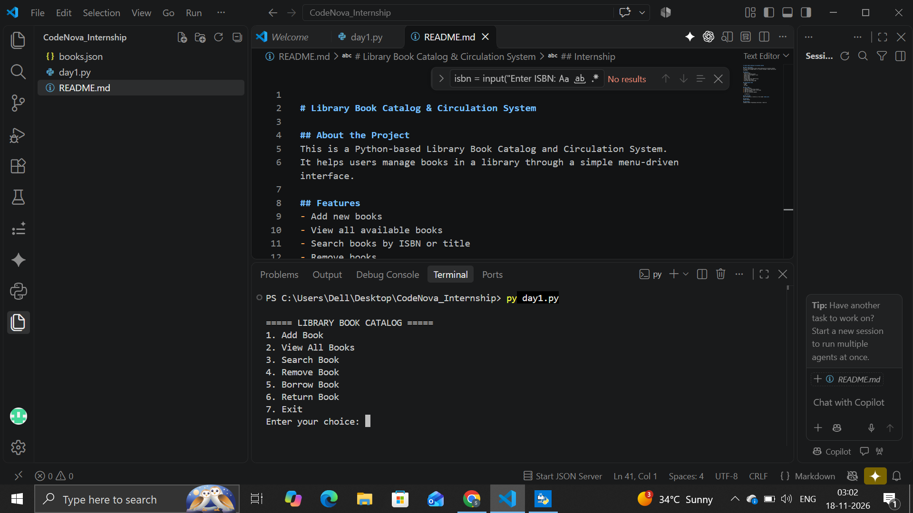
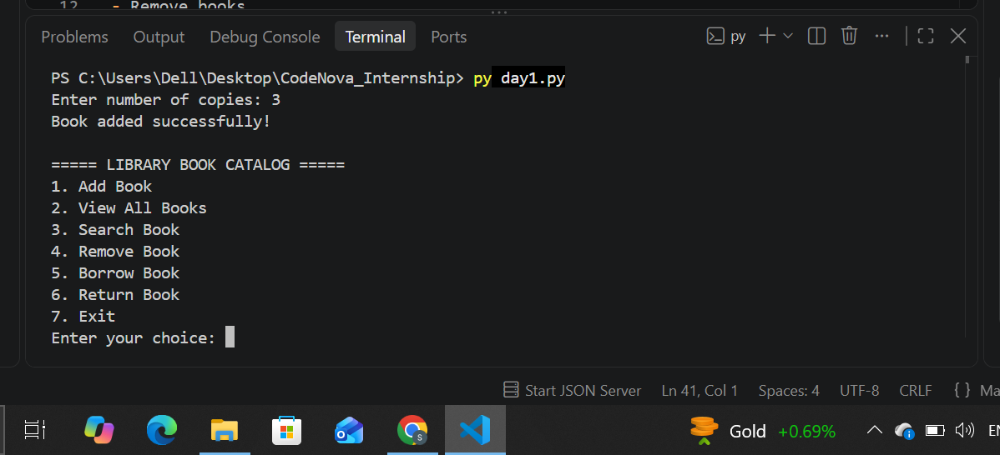
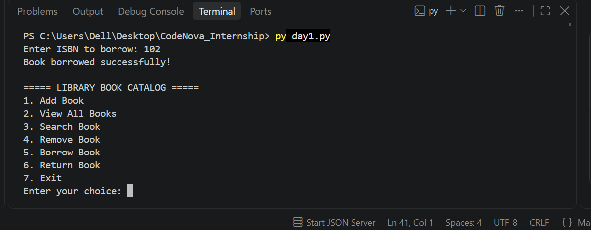
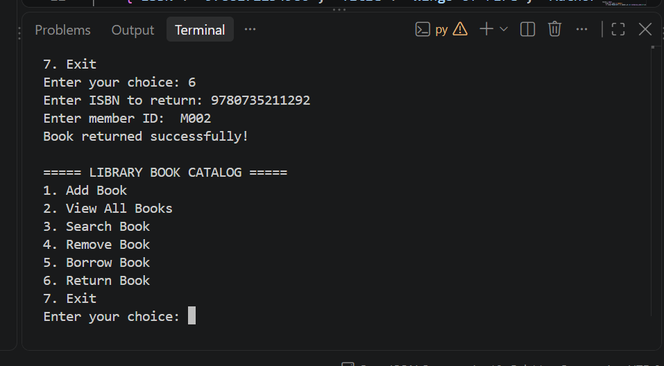
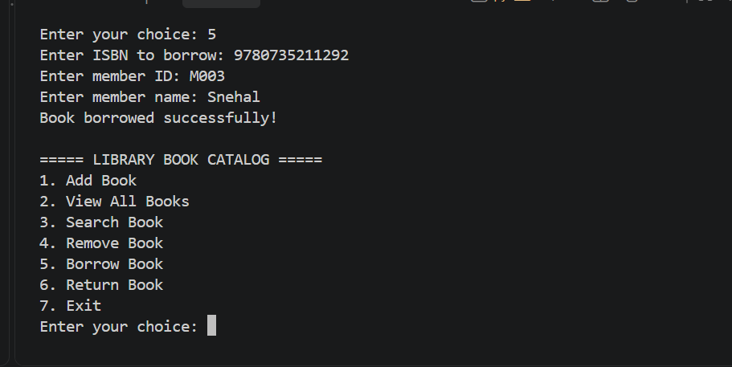

# Task 1: Library Book Catalog

## Project Description
A Python-based Library Book Catalog and Circulation CLI application that allows users to manage books, search the catalog, borrow books, and return books.

## How to Run

Open a terminal in the project folder and run:

```powershell
py day1.py
```

The program automatically creates and updates `books.json` and `members.json` for data persistence.

## Included Files

- `day1.py` — Main menu, book catalog, borrowing, and return operations.
- `storage.py` — JSON data storage and persistence.
- `validation.py` — ISBN and input validation.
- `books.json` — Stores book records.
- `members.json` — Stores borrowing records.

## Features

- Add new books
- View all books
- Search books by title or author
- Remove books
- Borrow books
- Return books
- Input validation
- Persistent JSON storage

## Technologies Used

- Python
- JSON
## Project Screenshots

### Main Menu


### Add Book


### Borrow Book


### Additional Borrow Screenshot

### Return Book

